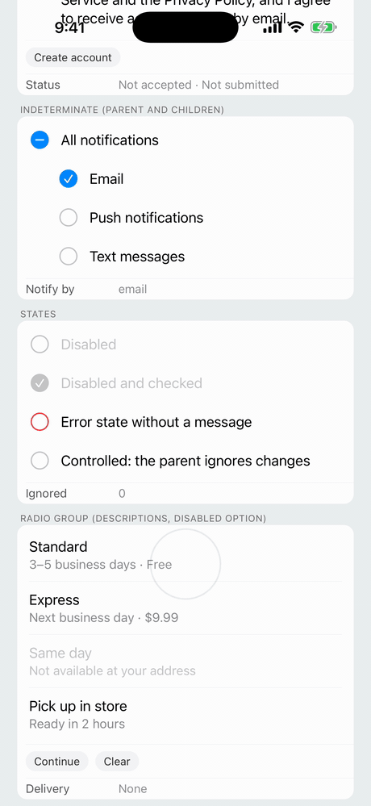
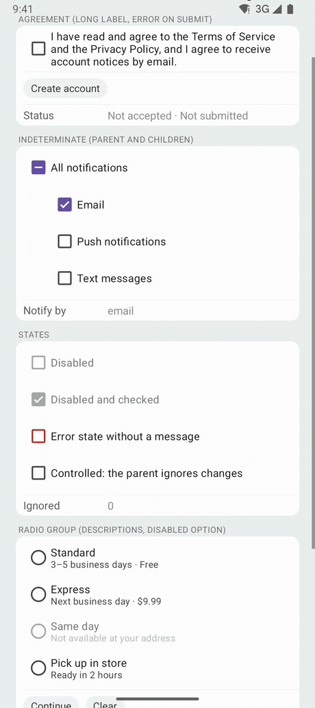

<table>
  <tr>
    <td align="center"><strong>iOS</strong></td>
    <td align="center"><strong>Android</strong></td>
  </tr>
  <tr>
    <td></td>
    <td></td>
  </tr>
</table>

A single choice from a short list, such as an account type or a delivery method, with an optional description under each option and a validation message under the group.

- **Android**: Material 3 `MaterialRadioButton`s in an Android `RadioGroup`, in the app's Material theme. Each option is one radio button whose text is the label and, under it, the description.
- **iOS**: there is no system radio button. The component draws the list idiom of Settings (a table cell's checkmark accessory): rows separated by hairlines, with a trailing `checkmark` in the tint color on the chosen row. Rows highlight while pressed like list cells.
- **Web**: native `<input type="radio">`s sharing one name, in a `radiogroup`.

| iOS 26                                                                                                                                    | Android                                                                                                                           |
| ----------------------------------------------------------------------------------------------------------------------------------------- | --------------------------------------------------------------------------------------------------------------------------------- |
|  |  |
|  |  |

```tsx
import { RadioGroup } from 'react-native-platform-components';

const [delivery, setDelivery] = useState<string | null>(null);
const [error, setError] = useState<string>();

<RadioGroup
  accessibilityLabel="Delivery method"
  options={[
    { value: 'standard', label: 'Standard', description: '3–5 business days · Free' },
    { value: 'express', label: 'Express', description: 'Next business day · $9.99' },
    { value: 'sameDay', label: 'Same day', description: 'Not available at your address', disabled: true },
    { value: 'pickup', label: 'Pick up in store', description: 'Ready in 2 hours' },
  ]}
  value={delivery}
  onValueChange={(value) => {
    setDelivery(value);
    setError(undefined);
  }}
  error={error}
/>

<Button
  title="Continue"
  onPress={() => {
    if (!delivery) setError('Choose a delivery method');
  }}
/>
```

### Props

| Prop                    | Type                                                                                           | Description                                                                                                                       |
| ----------------------- | ---------------------------------------------------------------------------------------------- | --------------------------------------------------------------------------------------------------------------------------------- |
| `options`               | `RadioGroupOption[]`                                                                           | Options, top to bottom. See [RadioGroupOption](#radiogroupoption)                                                                 |
| `value`                 | `string \| null`                                                                               | Value of the chosen option (controlled). `null` / unset: none chosen yet. See [Controlled value](#controlled-value)               |
| `onValueChange`         | `(value: string, index: number) => void`                                                       | Called when the user picks an option                                                                                              |
| `error`                 | `boolean \| string`                                                                            | Error state. A string is the validation message shown under the group. See [Validation message](#validation-message)              |
| `disabled`              | `boolean`                                                                                      | Disables every option                                                                                                             |
| `haptics`               | `'selection' \| 'light' \| 'medium' \| 'heavy' \| 'success' \| 'warning' \| 'error' \| 'none'` | Haptic played when the user picks an option. See [Haptics](/guides/haptics). Default: none                                        |
| `maxFontSizeMultiplier` | `number`                                                                                       | Largest scale the labels may reach with the system text size (Dynamic Type / font scale), as on `Text`. Unset or `0`: no cap      |
| `accessibilityLabel`    | `string`                                                                                       | Screen-reader name of the group, such as "Delivery method". See [Accessibility](#accessibility)                                   |
| `testID`                | `string`                                                                                       | Test identifier of the group, and the prefix of the options' default test IDs                                                     |

### RadioGroupOption

The option shape follows [ChipGroup](/components/chip#chipgroupitem)'s items.

| Property             | Type      | Description                                                                         |
| -------------------- | --------- | ----------------------------------------------------------------------------------- |
| `value`              | `string`  | Unique value returned in callbacks                                                  |
| `label`              | `string`  | Option text. It wraps                                                               |
| `description`        | `string`  | Secondary text under the label, such as "3–5 business days"                         |
| `disabled`           | `boolean` | Disables this option                                                                |
| `testID`             | `string`  | Test identifier of the option. Default: `` `${testID}-${value}` ``                  |
| `accessibilityLabel` | `string`  | Screen-reader label. Defaults to `label`                                            |

### Controlled value

`value` is controlled: a tap calls `onValueChange`, and the choice moves once `value` changes. If the parent doesn't update it, the choice goes back. On Android the `RadioGroup` checks the tapped option at once (with Material's animation) and returns to `value` once JavaScript has answered; on iOS the checkmark moves only when `value` does. Tapping the chosen option again does nothing, as with a native radio group. To clear the choice, set `value` to `null`.

### Validation message

`error` follows [TextField](/components/textfield)'s `error`: a string is the message shown under the group, such as "Choose a delivery method", and `true` shows the error look without one.

- **Android**: the message, lined up with the labels, in the theme's `colorError` and Material's supporting-text style (Body Small). TalkBack announces it when it appears (a polite live region). Material has no error state for radio buttons, so they keep their colors.
- **iOS**: the message under the last row in red (footnote), and the checkmark turns red. VoiceOver reaches the message after the options.
- **Web**: the message is the group's description (`aria-describedby`) and a polite live region, and the group has `aria-invalid`.

### Accessibility

Each option's testID, label and touch target are one element, which carries the radio role and the checked state, and the group has radio-group semantics where the platform has them:

- **Android**: each option is a `MaterialRadioButton` (TalkBack: "radio button, checked / not checked"), in an Android `RadioGroup`, whose accessibility node reports the group (`android.widget.RadioGroup`). `accessibilityLabel` names the group on Android 14+ (`AccessibilityNodeInfo.setContainerTitle`, like a fieldset's legend). TalkBack reads a description after the label, as the option's hint.
- **iOS**: each option is a row. iOS has no radio button trait, so, as React Native does for `accessibilityRole="radio"`, the row's accessibility value says it: the description, then "radio button, checked" or "radio button, unchecked". These words are English, as React Native's are. The group is a semantic group (`accessibilityContainerType`), which VoiceOver names with `accessibilityLabel` when it moves into it.
- **Web**: a `role="radiogroup"` labeled by `accessibilityLabel`, around native radio inputs.

The labels follow Dynamic Type and the font scale (capped by `maxFontSizeMultiplier`), and the rows lay out right to left in RTL languages.

### Testing

Each option's `testID` (by default `` `${testID}-${value}` ``) is what Detox's `by.id` matches:

- **iOS**: the row's `accessibilityIdentifier`. The group's `testID` is on the host view.
- **Android**: the `MaterialRadioButton`'s view tag.

```ts
await expect(element(by.id('delivery-express'))).toHaveLabel('Express');
await element(by.id('delivery-express')).tap();

if (device.getPlatform() === 'android') {
  await expect(element(by.id('delivery-express'))).toHaveToggleValue(true);
} else {
  await expect(element(by.id('delivery-express'))).toHaveValue(
    'Next business day · $9.99, radio button, checked'
  );
}
```

In Jest, the [mock](/guides/testing) renders a view with the radiogroup role and a `Pressable` per option with the radio role, its `testID` and `accessibilityState.checked`.

### Android theme

The radio buttons are built from the app's Material theme, so they take your colors, and they follow [`useNativeTheme`](/guides/theming). With an AppCompat theme they fall back to Material 3 defaults and log one warning (see [Android Theme Configuration](/guides/android-theme)).
