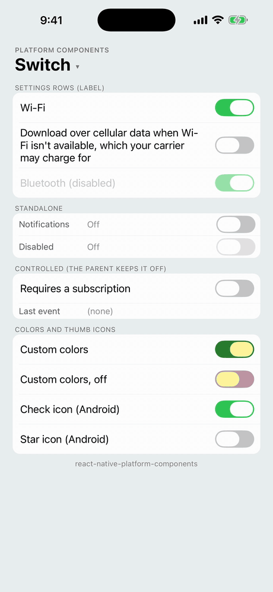
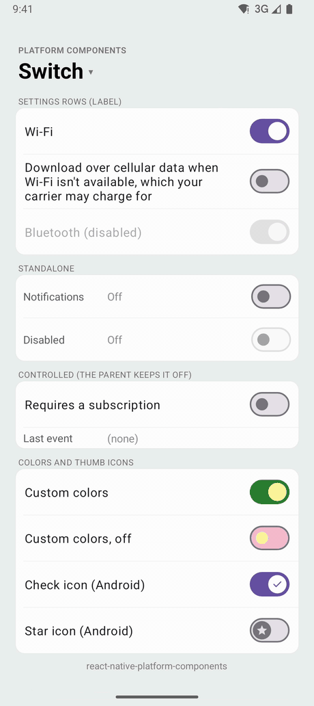

<table>
  <tr>
    <td align="center"><strong>iOS</strong></td>
    <td align="center"><strong>Android</strong></td>
  </tr>
  <tr>
    <td></td>
    <td></td>
  </tr>
</table>

An on / off control. With a `label`, it is a settings row: the label at the leading edge, the switch at the trailing edge, and a tap anywhere on the row toggles it.

- **Android**: Material 3 `MaterialSwitch` in the app's Material theme: the wider track, the thumb that grows when on, Material motion and optional thumb icons. React Native's own `Switch` is still the pre-Material 3 `SwitchCompat` on Android.
- **iOS**: `UISwitch` (Liquid Glass on iOS 26).
- **Web**: a checkbox with the switch role (`role="switch"`), drawn as a switch by Safari 17.4+.

| iOS 26                                                                                                         | Android                                                                                                                     |
| -------------------------------------------------------------------------------------------------------------- | --------------------------------------------------------------------------------------------------------------------------- |
|              |              |
|                     |                             |

```tsx
import { Switch } from 'react-native-platform-components';

const [wifi, setWifi] = useState(true);

// A settings row: the whole row toggles
<Switch label="Wi-Fi" value={wifi} onValueChange={setWifi} />

// A switch on its own, next to your own content
<Switch
  accessibilityLabel="Notifications"
  value={notifications}
  onValueChange={setNotifications}
/>
```

### Props

| Prop                    | Type                                                                                           | Description                                                                                                                                         |
| ----------------------- | ---------------------------------------------------------------------------------------------- | --------------------------------------------------------------------------------------------------------------------------------------------------- |
| `value`                 | `boolean`                                                                                      | Whether the switch is on (controlled). See [Controlled value](#controlled-value). Default: `false`                                                  |
| `onValueChange`         | `(value: boolean) => void`                                                                     | Called with the new value when the user toggles the switch                                                                                          |
| `disabled`              | `boolean`                                                                                      | Disables the switch (and its row)                                                                                                                   |
| `label`                 | `string`                                                                                       | Makes it a settings row with this text at the leading edge. See [Settings row](#settings-row)                                                       |
| `color`                 | `ColorValue`                                                                                   | Track color while on. Default: the theme's. See [Colors](#colors)                                                                                   |
| `trackColor`            | `ColorValue`                                                                                   | Track color while off. Default: the theme's                                                                                                         |
| `thumbColor`            | `ColorValue`                                                                                   | Thumb color, on and off. Default: the theme's                                                                                                       |
| `haptics`               | `'selection' \| 'light' \| 'medium' \| 'heavy' \| 'success' \| 'warning' \| 'error' \| 'none'` | Haptic played when the user toggles the switch. See [Haptics](/guides/haptics). Default: none                                                       |
| `maxFontSizeMultiplier` | `number`                                                                                       | Largest scale the label may reach with the system text size (Dynamic Type / font scale), as on `Text`. Unset or `0`: no cap                         |
| `accessibilityLabel`    | `string`                                                                                       | Screen-reader label. Defaults to `label`. Give a switch without a `label` one                                                                       |
| `testID`                | `string`                                                                                       | Test identifier of the element that has the label and the state and takes the touches: the row with a `label`, the switch without one             |
| `android.thumbIcon`     | `'check' \| PlatformIcon`                                                                      | Icon on the thumb. See [Thumb icons](#thumb-icons-android)                                                                                         |

`Switch` also takes the usual view props (`style` and so on).

### Controlled value

`Switch` is controlled, with React Native's `Switch` semantics. A tap (or a drag of the thumb) moves the switch and calls `onValueChange` with the new value; when JavaScript has answered, the switch shows `value` again. So a parent that stores the new value keeps the switch where the user put it, and a parent that doesn't (a setting that needs a subscription, a request that failed) sends it back:

```tsx
// Follows the user
<Switch label="Wi-Fi" value={wifi} onValueChange={setWifi} />

// Always goes back off
<Switch
  label="Sync over cellular"
  value={false}
  onValueChange={() => showUpgradePrompt()}
/>
```

A parent that sets `value` later, after an async call, sees the switch go back first and then move to the new value.

### Settings row

With `label`, the component is a row: the label at the leading edge in the platform's body text (UIKit's body style on iOS, Material's `textAppearanceBodyLarge` on Android), the switch at the trailing edge, both centered vertically. Right to left, the two swap sides.

- The whole row toggles the switch: a tap on the label, on the space between, or on the row's padding. A tap or drag on the switch itself goes to the switch, as usual.
- The label wraps onto more lines when the row is narrow (or the text is large), and the row grows to fit it. It follows the system text size, up to `maxFontSizeMultiplier`.
- The row has no padding or height of its own: give it the spacing your list uses through `style`. Padding is part of the row, so a tap there toggles it too.
- On Android the row has Material's ripple (`selectableItemBackground`), as Material list items do. iOS rows don't highlight, as in UIKit.
- Disabled, the label dims with the switch: UIKit's disabled label color on iOS, Material's 38% content opacity on Android.

```tsx
<Switch
  style={{ paddingHorizontal: 16, paddingVertical: 8, minHeight: 48 }}
  label="Download over cellular data when Wi-Fi isn't available"
  value={cellular}
  onValueChange={setCellular}
/>
```

Without a `label` the component is the size of the switch. If a layout makes it wider (a column's default `alignItems: 'stretch'`), the switch sits at the leading edge and only the switch takes taps.

### Accessibility

The switch (or its row) is one element with the switch role, its on / off state and its label, so VoiceOver and TalkBack read it once: "Wi-Fi, switch, on".

- **iOS**: with a `label`, the row is the accessibility element, with `UISwitch`'s traits and value ("1" or "0", read as on / off), and VoiceOver's double tap toggles it. Without one, the `UISwitch` itself is the element.
- **Android**: the component's view is the element, with the `android.widget.Switch` class, checkable and checked state, and `contentDescription` for the label. The `MaterialSwitch` inside it is hidden from TalkBack.

### Colors

Leave the colors unset to follow the theme:

- **Android**: the Material theme's colors (`colorPrimary` for the track while on, `colorOnPrimary` for the thumb, `colorOutline` and `colorSurfaceContainerHighest` while off), including your brand color from [`useNativeTheme`](/guides/theming).
- **iOS**: UIKit's green while on, or the brand color from `useNativeTheme` when one is set (the way SwiftUI's `Toggle` follows the tint).

`color` replaces the on track color, `trackColor` the off track color, and `thumbColor` the thumb in both states. Disabled switches keep the theme's disabled colors.

| iOS 26                                                                                                                | Android                                                                                                                                         |
| --------------------------------------------------------------------------------------------------------------------- | ----------------------------------------------------------------------------------------------------------------------------------------------- |
|                                   |  |

- **iOS**: `color` is `onTintColor` and `thumbColor` is `thumbTintColor`. UIKit has no off track color: `trackColor` goes behind the switch, where it shows through UIKit's translucent off track (as with React Native's `Switch`), so it looks lighter than the color you pass.
- **Android**: the `MaterialSwitch`'s `trackTintList` (on and off) and `thumbTintList`. Material's outline around the off track stays.

### Thumb icons (Android)

`android.thumbIcon` puts an icon on the Material 3 thumb (`thumbIconDrawable`), tinted by the theme:

- `'check'`: Material's check mark while the switch is on. While off, the thumb keeps its plain, smaller size.
- Any other [icon](/components/button#icons) (a drawable name, `{ type: 'drawable', name }` or `{ type: 'image', source }`): shown on and off, and the thumb takes its larger size in both states. To use a drawable named `check`, pass `{ type: 'drawable', name: 'check' }`.

```tsx
<Switch
  label="Dark theme"
  value={dark}
  onValueChange={setDark}
  android={{ thumbIcon: 'check' }}
/>
```

iOS has no thumb icons and ignores the option.

### Testing

The element with the `testID` is the one with the label and the state, and the one that takes the touches, so `by.id` finds, reads and taps one element:

```ts
await expect(element(by.id('settings-wifi'))).toHaveLabel('Wi-Fi');
await element(by.id('settings-wifi')).tap();
```

To read the state:

- **Android**: the element is `Checkable`, so `toHaveToggleValue(true)` works.
- **iOS**: Detox's `toHaveToggleValue` needs a `UISwitch`, which a row isn't; read its accessibility value instead, `"1"` for on and `"0"` for off (a switch without a label is a `UISwitch`, which reports the same).

```ts
const expectSwitch = (id: string, on: boolean) =>
  device.getPlatform() === 'android'
    ? expect(element(by.id(id))).toHaveToggleValue(on)
    : expect(element(by.id(id))).toHaveValue(on ? '1' : '0');
```

In Jest, the [mock](/guides/testing) renders a `Pressable` with the switch role, `testID`, `accessibilityState.checked` and the label as `Text`. Pressing it calls `onValueChange` with the other value, and `fireEvent(element, 'valueChange', true)` works as with React Native's `Switch`.

### Android theme

The switch is built from the app's Material theme, so it takes your colors, and it follows [`useNativeTheme`](/guides/theming) and light / dark changes. With an AppCompat theme it falls back to Material 3 defaults and logs one warning, like the other Material components (see [Android Theme Configuration](/guides/android-theme)).

### Web

A checkbox with `role="switch"` (and Safari's `switch` attribute, which draws a native switch in Safari 17.4+), tinted with `color` or the brand color through `accent-color`. With a `label` it is a `<label>` row, so a click anywhere on it toggles the box. The input carries the `testID` as `data-testid`. `trackColor`, `thumbColor`, `haptics`, `maxFontSizeMultiplier` and `android` are ignored.
